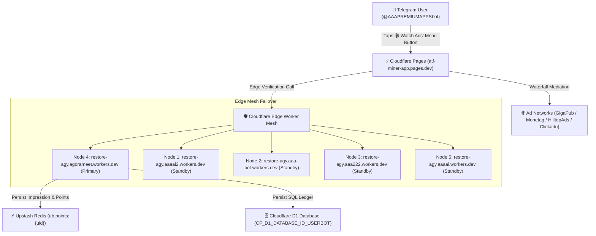

# 🎬 Cloudflare Pages Rewarded Ads Portal (`atf-miner-app.pages.dev`)
## Architecture, Waterfall Mediation & Integration Manual

> **Scope**: Official technical documentation for the dedicated Rewarded Ads Portal hosted on Cloudflare Pages (`https://atf-miner-app.pages.dev/`), its multi-network ad waterfall, edge mesh failover, and Telegram WebApp integration.
> **Privacy Directives**: Zero hardcoded personal IDs. All system and administrative credentials dynamically resolve via environment variables (`$REPORT_CHAT_ID`, `$USER_BOT_TOKEN`, `$CF_ACCOUNT_ID_USERBOT`).

---

## 📌 1. Executive Summary & Purpose

`atf-miner-app.pages.dev` is the dedicated, high-speed Cloudflare Pages production deployment of the **AAA Community Rewarded Ads Portal** (Dashboard 3).

* **Live Domain**: [`https://atf-miner-app.pages.dev/`](https://atf-miner-app.pages.dev/)
* **Hosting Platform**: Cloudflare Pages (Node 4 Account: `aaafreeai@gmail.com`)
* **Primary Role**: Serves high-converting rewarded video and banner ads to Telegram mini-app users to generate advertising yield, awarding **+20 community points** per verified impression.
* **Persistent Launchpad**: Permanently bound as the Telegram Chat Menu Button (`🎬 Watch Ads`) on the public User Bot (`@AAAPREMIUMAPPSbot`).
* **Source Code Location**: [`public_ads/index.html`](file:///data/workspace/AAA_AUTO/public_ads/index.html) *(Mirrored across `public/ad/index.html`, `public_ads/ad/index.html`)*.

---

## 🌐 2. Cloudflare Edge Infrastructure



### Edge Credentials & Isolated Bindings (from `.env`):
* **Cloudflare Pages Project**: `atf-miner-app`
* **Account ID**: `CF_ACCOUNT_ID_USERBOT` (`abbe3cc008ebb9dd029ded333fef6e9f`)
* **Dedicated Worker**: `CF_WORKER_URL_USERBOT` (`https://restore-agy.agorameet.workers.dev`)
* **Dedicated D1 Database**: `CF_D1_DATABASE_ID_USERBOT` (`265910ad-ee78-438d-8a5d-450f63b4ce7f`)
* **Dedicated KV Cache**: `CF_KV_CACHE_ID_USERBOT` (`c712ff7eb8e348988647038144708c82`)

---

## 📡 3. Multi-Network Waterfall Mediation

The portal does not rely on a single ad provider. It implements an autonomous client-side waterfall mediation that cascades down through multiple monetization networks until an ad is successfully served:

| Tier | Provider | Ad Format | Integration Type | Fallback Condition |
| :--- | :--- | :--- | :--- | :--- |
| **Tier 1** | **GigaPub SDK** | Rewarded Video | Direct JS SDK | No fill, network timeout, or ad block |
| **Tier 2** | **Monetag** | In-App Push / Video | Async Tag (`window.monetag`) | Script fails to load within 2,500ms |
| **Tier 3** | **HilltopAds** | VAST 3.0 / In-Card Video | Custom Canvas Video Player | VAST XML parse error or empty payload |
| **Tier 4** | **Clickadu / Adsterra**| Native Sponsored Display | Direct Banner / Creative Rotation | Network unavailable |
| **Tier 5** | **Adsgram** | Rewarded Video | Fallback Block ID (`config:adsgram_block_id`)| Emergency override |

### Visual 16.3s Countdown & Reward Security:
* **Audio-Visual Feedback**: Features HTML5 Web Audio API chimes and confetti bursts upon ad completion.
* **Anti-Cheat Validation**: The portal enforces a 16.3s watch timer with real-time frame tracking. If a user backgrounds or tampers with the webview, the timer pauses.
* **Auto-Advance Mode**: Users can toggle continuous ad viewing (`Auto-Advance`), allowing uninterrupted multi-ad viewing with 3-second grace intervals between videos.

---

## 🔐 4. Zero Hardcoded ID & Dynamic Session Extraction

To protect developer and owner privacy, **no personal Telegram IDs are ever hardcoded**. 

The portal resolves user identity purely dynamically through standard, non-invasive extraction:

```javascript
// Dynamic Identity Resolution Protocol (public_ads/index.html)
function resolveAdTelegramUser() {
  // 1. First priority: Telegram WebApp Launch Data
  if (window.Telegram?.WebApp?.initDataUnsafe?.user) {
    return window.Telegram.WebApp.initDataUnsafe.user;
  }
  // 2. Second priority: Query parameter or hash string (tgWebAppData)
  const urlParams = new URLSearchParams(window.location.search || window.location.hash.slice(1));
  const rawData = urlParams.get('tgWebAppData');
  if (rawData) {
    const parsed = new URLSearchParams(rawData);
    const userJson = parsed.get('user');
    if (userJson) return JSON.parse(decodeURIComponent(userJson));
  }
  // 3. Third priority: Standalone uid parameter
  const uidParam = urlParams.get('uid');
  if (uidParam) return { id: uidParam, first_name: "Miner" };
  
  return null;
}
```

Administrative commands, alert webhooks, and private recipient routing in backend handlers strictly resolve through:
```python
# Backend Owner Routing (Never Hardcoded)
OWNER_CHAT_ID = os.getenv("REPORT_CHAT_ID") or os.getenv("OWNER_ID")
```

---

## 🤖 5. Telegram User Bot Integration (`@AAAPREMIUMAPPSbot`)

The portal integrates cleanly with the public User Bot while maintaining strict **Zero Ecosystem Mixing**:

1. **Persistent Menu Button**:
   - `setChatMenuButton` is configured across all scopes (global and administrator) to text: **`🎬 Watch Ads`** and web_app URL: `https://atf-miner-app.pages.dev/`.
2. **Inline Action Keyboards**:
   - Every ad notification, points milestone, and daily bonus unlock contains an inline WebApp button launching `https://atf-miner-app.pages.dev/`.
3. **Strict Separation Directive**:
   - User Bot never exposes fleet admin commands (`/fleet`, `/farm`, `/acc`).
   - Admin Bot (`@myagyai`) never posts ad feeds or public points notifications.

---

## 🚀 6. Cloud Deployment Instructions

Whenever modifications are made to `public_ads/index.html`:

```bash
# 1. Verify byte equality with mirrors
python3 -c "
import filecmp
assert filecmp.cmp('public_ads/index.html', 'public/ad/index.html')
assert filecmp.cmp('public_ads/index.html', 'public_ads/ad/index.html')
print('✓ Mirror verification passed!')
"

# 2. Deploy Cloudflare Pages (atf-miner-app)
npx wrangler pages deploy public_ads --project-name=atf-miner-app --commit-dirty=true

# 3. Synchronize Edge Workers & Telegram Menu Button
python3 deploy_both_cf_workers.py
```
